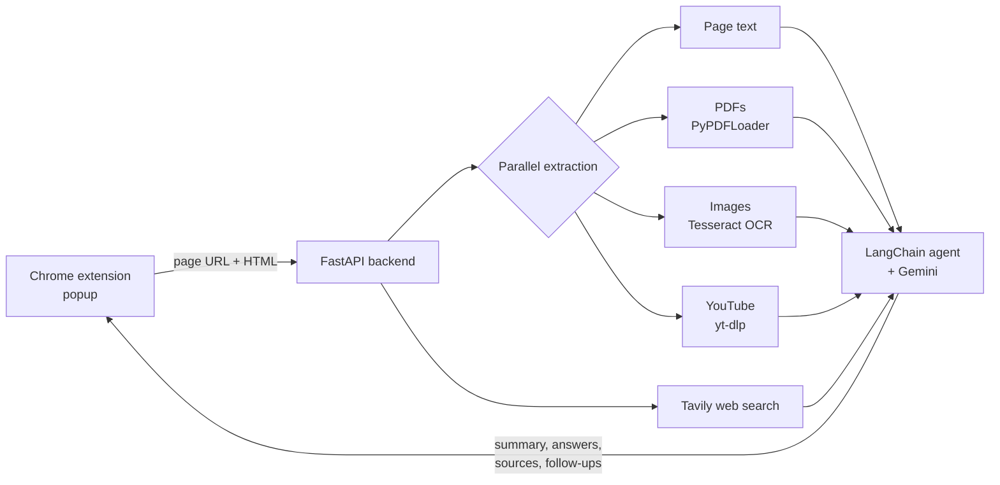

<div align="center">

<a href="https://rayaanq.github.io/Portfolio/#case-summarizer">
  <picture>
    <source media="(prefers-color-scheme: dark)" srcset="https://raw.githubusercontent.com/RayaanQ/RayaanQ/main/assets/card-summarizer-dark.svg">
    
  </picture>
</a>

# AI Web Page Summarizer

**A Chrome extension that summarizes any web page, including its PDFs, images and videos, and lets you chat with it, grounded by retrieval-augmented generation.**


[Case study](https://rayaanq.github.io/Portfolio/#case-summarizer) · [Setup](#-getting-started) · [API](#-api)

</div>

---

## ✦ Why

Information overload is real, and most pages are more than text. They embed PDFs, put key facts inside screenshots, and link to videos. Most summarizers read the HTML and ignore everything else. This extension reads **all of it**, then lets you ask follow-up questions with sources you can click.

## ✦ Features

| | |
|---|---|
| 📝 **One-click summaries** | Short, medium or detailed, formatted as bullet points with a word count |
| 💬 **Chat with the page** | Context-aware Q&A with session memory and AI-suggested follow-up questions |
| 🔎 **RAG with live search** | Merges page content with [Tavily](https://tavily.com) web results, and every answer cites clickable sources |
| 📄 **PDFs** | Extracts embedded documents with `PyPDFLoader` |
| 🖼️ **Images** | Reads text inside images with Tesseract OCR |
| 🎥 **Video** | Pulls YouTube transcripts with `yt-dlp` |
| ⚡ **Fast** | Media sources are processed in parallel, and search results are cached per session |

## ✦ How it works



## ✦ Getting started

### 1. Backend

```bash
python -m venv venv
source venv/bin/activate        # Windows: venv\Scripts\activate
cd backend
pip install -r requirements.txt
```

Create `backend/.env`:

```env
GEMINI_API_KEY=your_gemini_api_key          # required: https://aistudio.google.com/app/apikey
TAVILY_API_KEY=your_tavily_api_key          # optional: enables RAG web search
OPENAI_API_KEY=your_openai_api_key          # optional: better embeddings (falls back without it)
```

Install the system tools used for media extraction:

| Tool | Used for | Install |
|---|---|---|
| FFmpeg | video transcripts (`yt-dlp`) | `brew install ffmpeg` · `sudo apt-get install ffmpeg` · [Windows](https://ffmpeg.org/download.html) |
| Tesseract OCR | text in images | `brew install tesseract` · `sudo apt-get install tesseract-ocr` · [Windows](https://github.com/UB-Mannheim/tesseract/wiki) |

Run it:

```bash
uvicorn main:app --reload --port 8000
```

Open http://localhost:8000 to check the API status.

### 2. Chrome extension

1. Go to `chrome://extensions/` and switch on **Developer mode**.
2. Click **Load unpacked** and pick the `extension` folder.
3. Open any page, click the extension icon, choose a summary length, and press **Summarize**.

> The extension calls `http://localhost:8000`. If you run the backend elsewhere, update the API URL in `popup.js`.

## ✦ API

| Method | Endpoint | Description |
|---|---|---|
| `GET` | `/` | Health check and feature status |
| `POST` | `/summarize` | Summarize a page, including extracted media |
| `POST` | `/chat` | Q&A over the page with RAG |
| `GET` | `/session/{session_id}` | Session info and history |
| `DELETE` | `/session/{session_id}` | Delete a session and clean up |

## ✦ Tech stack

| Layer | Tools |
|---|---|
| LLM and orchestration | Gemini, LangChain agents |
| Retrieval | Tavily search, session-level caching |
| Media extraction | PyPDFLoader, Tesseract OCR (`pytesseract`), `yt-dlp` + FFmpeg |
| Backend | FastAPI, Uvicorn, Docker |
| Extension | Vanilla JavaScript, Chrome Extension APIs |

## ✦ Troubleshooting

- **API key errors:** check that `backend/.env` contains `GEMINI_API_KEY`.
- **CORS errors:** make sure the backend is running on port 8000.
- **Videos or images aren't extracted:** install FFmpeg and Tesseract (see above).
- **Slow responses:** RAG search plus media extraction can take 10–30 seconds on heavy pages.

---

<div align="center"><sub>Built by <a href="https://github.com/RayaanQ">Rayaan Quraishi</a> · <a href="https://rayaanq.github.io/Portfolio/">Portfolio</a> · <a href="https://www.linkedin.com/in/rayaan-quraishi">LinkedIn</a></sub></div>
